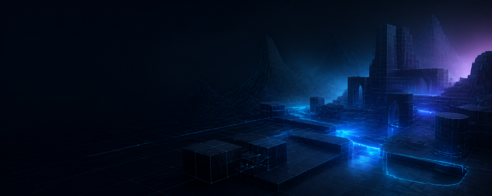

<h1 align="center">Mukund Pareek</h1>

  <strong>Gameplay programmer · Multiplayer systems · Developer tools</strong> 
  C++ and Unreal Engine, with experiments in browser games and AI-assisted tooling.

  <a href="https://mukund-portfolio-chi.vercel.app/"><strong>Portfolio & case studies</strong></a>
  &nbsp;·&nbsp;
  <a href="https://mukund-pareek.itch.io/"><strong>Play my games</strong></a>
  &nbsp;·&nbsp;
  <a href="https://mukund-portfolio-chi.vercel.app/"><strong>Contact</strong></a>
  &nbsp;·&nbsp;
  <a href="https://www.linkedin.com/in/mukund-pareek/">LinkedIn</a>

  

I build gameplay systems, multiplayer architecture, and tools for Unreal Engine projects. My work spans character movement, combat, abilities, AI, and editor workflows.

## Play something I've built

<table>
<tr>
<td width="50%" valign="top">
<h3>Impulse</h3>

<strong>Jetpack arena shooter · Unreal Engine · Windows</strong>

Fight bots across two vertical arenas. Manage fuel, recover from falls, and switch between seven weapons.

Available as an in-development Windows build. The published version is single-player; multiplayer is planned.

<a href="https://mukund-pareek.itch.io/impulse"><strong>Download Impulse →</strong></a>

</td>
<td width="50%" valign="top">
<h3>LoopStruck</h3>

<strong>Time-loop platformer · Godot · Browser</strong>

Your previous attempts become part of the level. Arrange objects on one run, then use their replayed actions to escape on the next.

Six rooms built around a countdown and persistent consequences.

<a href="https://mukund-pareek.itch.io/loopstruck"><strong>Play in your browser →</strong></a>

</td>
</tr>
</table>

## Explore the engineering

| Project | What to inspect | Evidence |
| :--- | :--- | :--- |
| **UnitZero** | Server-validated shooting, per-bone lag compensation, GAS, and network diagnostics. | [Networking case study](https://mukund-portfolio-chi.vercel.app/work/unitzero) |
| **GeoTracker** | A custom Unreal Editor Mode with viewport measurement, click-drag interaction, and Slate tooling. Prototype in progress. | [Editor workflow & case study](https://mukund-portfolio-chi.vercel.app/work/geotracker) |
| **Minesweeper AI Chat Plugin** | An Unreal Editor plugin with a Slate chat interface, provider-specific HTTP handling, and playable generated grids. | [C++ source & architecture](https://github.com/MukundPareek15/Chatbot-GameGeneration) |
| **UnrealBuddy** | A Windows adaptation of Clicky with Unreal-specific context, screen capture, streaming responses, and cursor guidance. | [Python source & setup](https://github.com/MukundPareek15/Unreal-Buddy) |
| **NeonStrike** | A browser arena shooter using HTML5 Canvas, Node.js, and Socket.IO, with Base Sepolia integrations. | [JavaScript source](https://github.com/MukundPareek15/NeonStrike) |

UnitZero and GeoTracker link to public case studies. The source links above lead to public repositories.

<strong>More prototypes and learning projects</strong>

- [GAS System 5.3](https://github.com/MukundPareek15/GAS-System-5.3): abilities, replicated attributes, Gameplay Effects, and reactive UI.
- [WWE CommonUI Menu](https://github.com/MukundPareek15/WWE_Main_Menu): a front-end menu prototype built around CommonUI.
- [Paper Project](https://github.com/MukundPareek15/Paper_Project): Blueprint-first 2D combat and inventory exploration with Paper2D and PaperZD.
- [CodeCrafters Shell](https://github.com/MukundPareek15/codecrafters-shell-cpp): C++ practice through the Build Your Own Shell challenge.

## What I work with

| Area | Tools & systems |
| :--- | :--- |
| Gameplay | C++, Unreal Engine 5, Blueprints, Gameplay Ability System, Enhanced Input |
| Multiplayer | Replication, server-authoritative gameplay, movement prediction, lag compensation |
| Interfaces & tools | Slate, UMG, CommonUI, Python, PySide6 |
| Browser experiments | JavaScript, HTML5 Canvas, Node.js, Socket.IO |

---

**Building a game or an Unreal tool?** [Get in touch through my portfolio](https://mukund-portfolio-chi.vercel.app/) with the system you need built.

[Portfolio](https://mukund-portfolio-chi.vercel.app/) · [itch.io](https://mukund-pareek.itch.io/) · [LinkedIn](https://www.linkedin.com/in/mukund-pareek/) · [X](https://x.com/MukundPareek)
